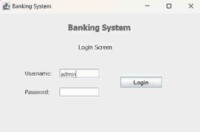
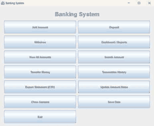
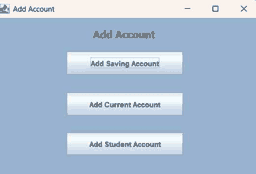

# Banking Management System

[](https://github.com/purnendu2318/Banking-Management-System/actions/workflows/java-ci.yml)

A Java Swing desktop application that demonstrates common banking workflows, object-oriented account models, transaction records, local file persistence, CSV statements, and a lightweight regression test suite.

> **Educational project only.** This application is not production banking software. Do not use it to store real customer information, credentials, or money.

## Screenshots

| Login | Dashboard / Reports | Add Account |
|---|---|---|
|  |  |  |

## Features

| Module | What it demonstrates |
|---|---|
| Authentication | Single administrator demo login with configurable environment variables and a five-attempt lock during the current run |
| Account management | Create, search, list, rename, and close savings, current, and student accounts |
| Cash operations | Deposit and withdraw with amount, minimum-balance, and account-specific withdrawal validation |
| Transfers | Transfer between different accounts with per-transfer and daily outgoing limits |
| Transaction history | Record account activity and show transactions associated with an account |
| Statements | Export an account's transaction history to CSV |
| Dashboard | Display account counts, total current balance, and today's transaction count |
| Persistence | Save and restore application state using Java object serialization |
| Tests | Run core-domain regression tests without external test dependencies |

## Technology stack

- Java 17 (JDK 11+ is the documented minimum)
- Java Swing (desktop GUI)
- Object-oriented Java: inheritance, encapsulation, and exception handling
- Java serialization and file I/O
- CSV export
- GitHub Actions for continuous integration

**Storage note:** the current version stores data in a local serialized file named `data`. It does **not** use MySQL, JDBC, Spring Boot, or a web backend.

## Getting started

### Prerequisites

1. Install JDK 17 (or JDK 11 or newer).
2. Confirm that both `java` and `javac` are available in your terminal.
3. Clone this repository:

```bash
git clone https://github.com/purnendu2318/Banking-Management-System.git
cd Banking-Management-System
```

Check your Java installation:

```bash
java -version
javac -version
```

### Compile and run

Open a terminal in the repository root (the directory containing `src/`).

**Windows PowerShell**

```powershell
New-Item -ItemType Directory -Force bin | Out-Null
javac -encoding UTF-8 -d bin -sourcepath src src\Application.java
java -cp bin Application
```

**macOS / Linux**

```bash
mkdir -p bin
javac -encoding UTF-8 -d bin -sourcepath src src/Application.java
java -cp bin Application
```

### Demo login

For a local demonstration, the default credentials are:

- Username: `admin`
- Password: `admin`

You can override them before launching the application.

**Windows PowerShell**

```powershell
$env:BANK_ADMIN_USER = "your-demo-user"
$env:BANK_ADMIN_PASSWORD = "choose-a-local-demo-password"
java -cp bin Application
```

**macOS / Linux**

```bash
export BANK_ADMIN_USER="your-demo-user"
export BANK_ADMIN_PASSWORD="choose-a-local-demo-password"
java -cp bin Application
```

These values are read from environment variables by the demo login; this is not secure credential storage. Do not reuse a real password.

### Where application data is stored

The application creates a local file named `data` in the working directory when records are saved. The save routine writes to `data.tmp` and then replaces the target file. If an existing data file cannot be read, the application attempts to preserve a copy as `data.backup` and starts with a new in-memory bank.

- Keep `data` and any backups private.
- Back up the file before experimenting with changes.
- Do not commit local data files or exported statements.
- Run the application from the same working directory when you want it to reopen the same data file.

## Run the tests

The test harness has no third-party dependency.

**Windows PowerShell**

```powershell
New-Item -ItemType Directory -Force bin | Out-Null
javac -encoding UTF-8 -d bin -sourcepath src src\Application.java tests\BankingSystemTests.java
java -ea -cp bin BankingSystemTests
```

**macOS / Linux**

```bash
mkdir -p bin
javac -encoding UTF-8 -d bin -sourcepath src src/Application.java tests/BankingSystemTests.java
java -ea -cp bin BankingSystemTests
```

The regression suite exercises account creation and lookup, deposits, invalid amounts, minimum balances, withdrawals, transfers, transfer limits, dashboard metrics, transaction history, account closure, defensive copies, and serialization round-tripping.

GitHub Actions runs the compile and test commands on pushes and pull requests to `main`.

## Architecture

The application is a layered desktop program. Swing screens call the banking domain model; `FileIO` loads and saves the `Bank` object as a local serialized file. The tests exercise the core banking domain directly.

See [docs/ARCHITECTURE.md](docs/ARCHITECTURE.md) for the architecture diagram and component responsibilities.

## Domain model

The model uses a base `BankAccount` class, specialized account types, a `Bank` collection/service class, and immutable `Transaction` records.

See [docs/DATA-MODEL.md](docs/DATA-MODEL.md) for the class diagram and relationship notes. This is a **class/data-model diagram, not a database ER diagram**, because the current application has no relational database.

## Security and known limitations

This project is intended for learning and demonstrations. Important limitations include:

- Demo credentials default to `admin/admin`; environment variables are not a substitute for password hashing or a real identity system.
- The application is designed for one local user. It does not implement production roles, authorization policies, or multi-user concurrency controls.
- Money is represented using Java `double`; production financial software should use `BigDecimal` or integer minor units with explicit rounding rules.
- State is stored using Java serialization in a local file, not a database. The file should be treated as trusted local input and protected from unauthorized modification.
- The transfer flow is designed for a single-user desktop process and is not backed by database transactions or distributed locking.
- Account closure records the remaining balance as a simulated cash payout; no real funds are moved.

More detail and a prioritized hardening checklist are in [docs/SECURITY-AND-LIMITATIONS.md](docs/SECURITY-AND-LIMITATIONS.md).

## Suggested demo recording

A short screen recording can make the repository easier to review. Suggested flow: log in, create one account, deposit, withdraw, transfer between two accounts, open transaction history, view the dashboard, and export a CSV statement. Use fictional names and balances only. A recording is not included in this repository yet.

## Project structure

```text
.
├── .github/
│   └── workflows/java-ci.yml
├── docs/
│   ├── ARCHITECTURE.md
│   ├── DATA-MODEL.md
│   └── SECURITY-AND-LIMITATIONS.md
├── screenshots/
│   ├── add-account.png
│   ├── dashboard.png
│   └── login.png
├── src/
│   ├── Application.java
│   ├── Bank/          # Accounts, bank operations, transactions
│   ├── Data/          # Local serialized persistence
│   ├── Exceptions/    # Domain-specific exceptions
│   └── GUI/           # Swing windows and dialogs
└── tests/
    └── BankingSystemTests.java
```

## License

No license is currently included. The repository is publicly viewable, but that does not by itself grant general permission to reuse, modify, or redistribute the code. Add a license if you decide to grant those permissions.
