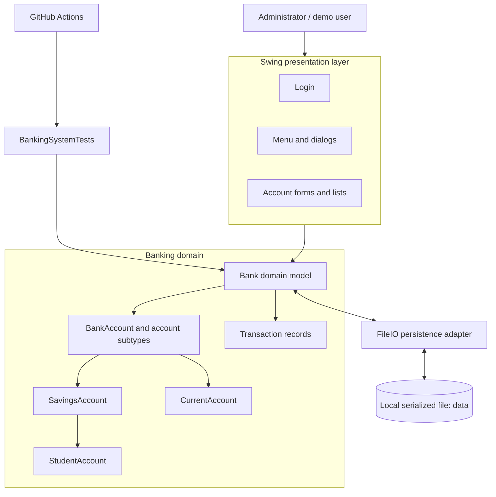

# Application Architecture

## Overview

This repository is a Java Swing desktop application. It currently uses local Java object serialization for persistence; there is no relational database, JDBC layer, REST API, or hosted backend.

## Component diagram

## Responsibilities

| Component | Responsibility |
|---|---|
| `Application` | Starts the Swing application on the AWT event-dispatch thread |
| `GUI` | Login, navigation, account forms, deposit/withdraw dialogs, reports, and CSV export |
| `Bank` | Owns the active account collection, validates banking operations, applies transfer limits, and records transactions |
| `BankAccount` | Holds account identity, holder name, balance, and minimum-balance rules |
| Account subtypes | Add savings withdrawal limits, current-account trade licence data, and student institution data |
| `Transaction` | Immutable record of an operation, related account, timestamp, amount, and resulting balance |
| `FileIO` | Reads and writes the `Bank` object to the local `data` file |
| `BankingSystemTests` | Exercises the core domain logic without opening Swing windows |
| GitHub Actions | Compiles the application and test harness, then runs the regression suite |

## Typical deposit flow

1. The user selects **Deposit** in the Swing menu.
2. The GUI reads the account number and amount.
3. The GUI calls `Bank.deposit(accountNumber, amount)`.
4. `Bank` validates the amount and account, updates the account balance, and records a `DEPOSIT` transaction.
5. The GUI invokes `FileIO.Write()` to persist the updated `Bank` object.

## Typical transfer flow

1. The GUI collects source and destination account numbers and an amount.
2. `Bank.transfer(...)` rejects invalid amounts, identical accounts, missing accounts, and transfers above the configured limits.
3. The source account is debited and the destination account is credited.
4. The bank records linked `TRANSFER_OUT` and `TRANSFER_IN` transactions.
5. The GUI saves the updated bank state.

## Current architecture boundaries

The GUI currently accesses the static `FileIO.bank` instance directly. This keeps the demo simple, but it couples presentation code to persistence. A future refactor could introduce a service layer and repository interface so the application can switch from local files to a database without rewriting the Swing screens.
