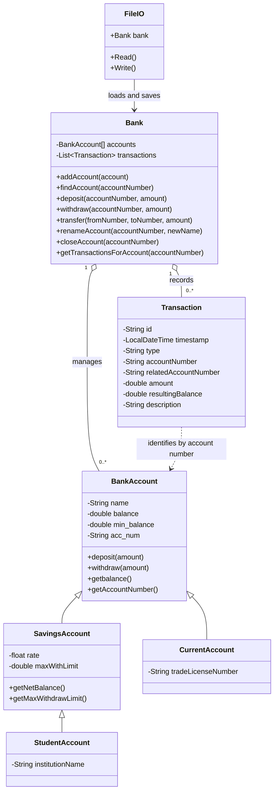

# Domain Data Model

## Why this is not an ER diagram

The current application does not use MySQL or another relational database. It persists a serialized Java `Bank` object to a local file. Therefore, a UML-style class diagram is the accurate representation of the current implementation. An ER diagram would incorrectly imply database tables and foreign keys that do not exist.

## Class diagram

## Relationship notes

- A `Bank` manages multiple active `BankAccount` instances and stores transaction history.
- `SavingsAccount` and `CurrentAccount` extend `BankAccount`.
- `StudentAccount` extends `SavingsAccount` and adds institution information.
- A `Transaction` stores account numbers as strings rather than holding direct object references.
- `FileIO` serializes the `Bank` object graph to the local `data` file.

## If a MySQL version is built later

A future relational design could use tables such as `customers`, `accounts`, `account_types`, `transactions`, and `users`, with primary keys, foreign keys, constraints, and database transactions. That would be a separate architectural change; those tables are not part of this repository's current implementation.
